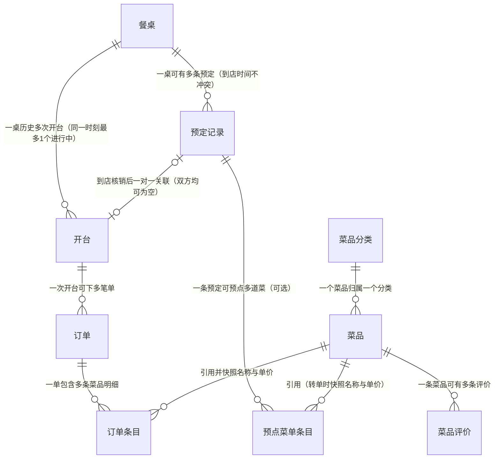
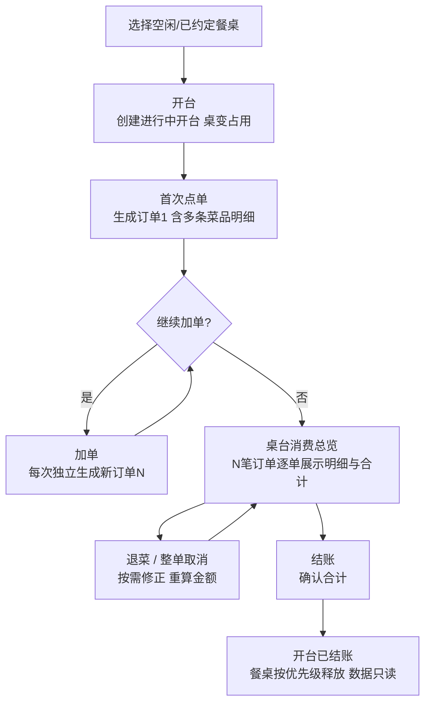
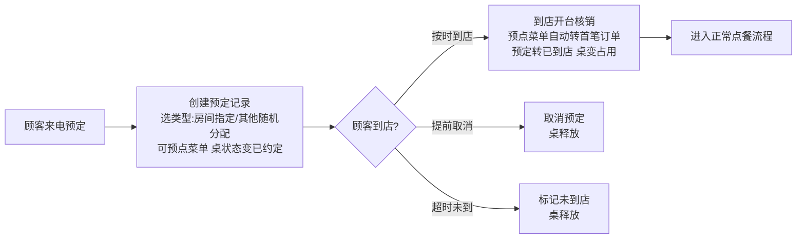
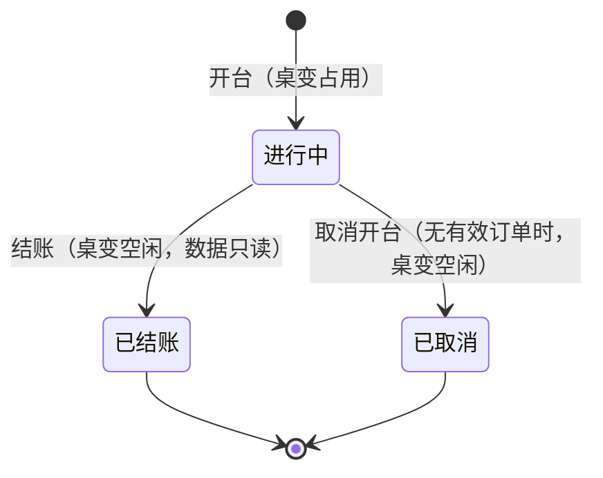
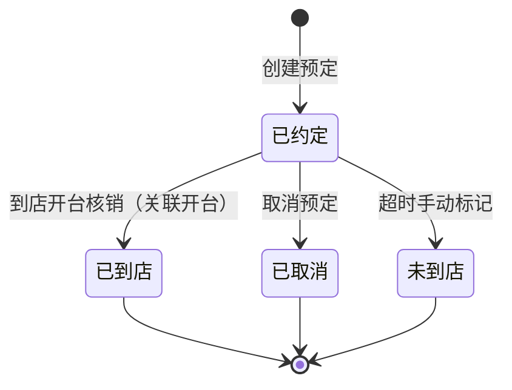
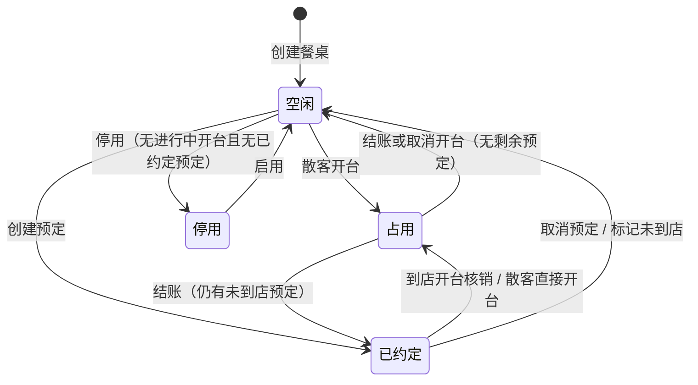

# 点餐系统需求文档（PRD）

- **版本**：v1.3
- **日期**：2026-10-30
- **文档目的**：本文档供开发 agent 作为点餐系统实现的唯一需求依据，覆盖业务对象、字段约束、状态流转、业务规则与边界条件。除标注 `[TBD]`（待确认）与 `[假设]`（推断，需确认）外，所有规则均为确定需求，实现时不得引入本文档之外的业务规则。

**阅读约定**

- 需求编号规则：`FR-{模块}-{序号}`，编号在全文中稳定唯一，可被测试、任务拆分直接引用。
- `[TBD]`：待业务确认的决策，实现前应向需求方确认；未确认前按括号内默认建议执行。
- `[假设]`：基于当前上下文的合理推断，已按推断写入规则正文。
- 术语以第 4 章对象定义为准（餐桌 / 开台 / 订单 / 订单条目 / 菜品分类 / 菜品 / 预定记录 / 预点菜单条目），全文不使用同义词。

---

## 1. 背景与目标

门店目前缺乏数字化的点餐管理能力，菜品、桌台与顾客消费记录无法关联，结账时需人工核对每桌点了什么、加了几次单。本系统在现有后台管理平台内新增点餐业务模块，由店员在后台完成代客点餐。

**目标（可观察结果）**

- 店员可完成完整闭环：选桌开台 → 点单/加单 → 查看该桌下了多少笔单、每单包含什么菜品 → 退菜修正 → 结账清台。
- 管理员可维护菜品分类、菜品、桌号，且维护操作（改价、改名、停售、停用）不破坏历史订单数据。
- 任意时刻查看某餐桌，能看到其当前就餐会话的累计下单笔数、每笔订单明细与合计金额。
- 店员可为顾客预定餐桌：按桌号类型预定（房间等可指定具体桌，其他类型按人数随机分配）、标记是否提前备菜、预点菜单（可选）；到店后一键开台核销，预点菜单自动转为首笔订单（桌状态变为"已约定"）。

## 2. 范围

**入口条件**：管理员已登录宿主后台系统（用户身份与登录鉴权由宿主系统提供，本系统不定义）。

**P0（本期必须交付，构成最小完整闭环）**

- 菜品分类管理：增删改查、启停、排序。
- 菜品管理：增删改查、在售/停售、归属分类、价格。
- 桌号管理：增删改查、停用、状态自动流转（含"已约定"预定态）。
- 预定桌号管理：创建/编辑预定（类型选择与房间指定/随机分配、提前备菜、预点菜单）、到店开台核销（预点菜单转首笔订单）、取消预定、未到店标记、预定列表。
- 订单管理：开台、点单、加单、桌台消费总览（核心）、条目退菜、整单取消、结账、取消开台、历史订单查询（基础筛选）。

**P1（本期不实现，但实现时不得阻碍后续扩展）**

- 各列表的搜索与筛选（名称关键词、状态、日期范围等高级筛选）。
- 删除分类前的菜品批量转移。
- 换桌、并桌。
- 预定逾期自动释放与到店提醒。
- 营业统计报表（按日/按桌营业额）。

**明确排除（不实现）**

- 顾客扫码自助点餐（本系统为店员代点模式）。
- 在线支付对接、收银台出票打印、厨房显示屏（KDS）。
- 会员、折扣、抹零、营销活动。
- 多门店、库存与沽清管理（菜品仅提供"停售"开关）。

## 3. 角色与权限

| 能力                                           | 店员             | 管理员 |
| ---------------------------------------------- | ---------------- | ------ |
| 开台 / 点单 / 加单                             | ✅               | ✅     |
| 条目退菜 / 整单取消 / 取消开台                 | ✅（需二次确认） | ✅     |
| 结账                                           | ✅（需二次确认） | ✅     |
| 预定管理（创建/编辑/取消/未到店标记/到店开台） | ✅               | ✅     |
| 查看进行中与历史订单                           | ✅               | ✅     |
| 桌号管理（增删改、停用）                       | ❌               | ✅     |
| 菜品分类管理                                   | ❌               | ✅     |
| 菜品管理（增删改、停售）                       | ❌               | ✅     |

- `[假设]` 角色仅此两种，由宿主后台的账号体系分配；本系统只做业务能力层面的权限区分。
- 所有关键操作（开台、下单、退菜、取消、结账、预定创建/编辑/取消/核销/未到店标记）必须记录操作人与操作时间。

## 4. 核心对象与关系

### 4.1 对象层级

为满足"知道某一桌下了多少单、每单下了什么内容"，引入**开台（就餐会话）**作为餐桌与订单之间的归属对象：同一桌在不同餐次的开台互相隔离，一次开台内可产生多笔订单。

### 4.2 对象定义

| 对象 | 定义 | 关键归属 |
| --- | --- | --- |
| 餐桌 | 门店内一个可供就餐的物理桌位，以桌号唯一标识，以"类型"区分大厅、外摆、房间等 | — |
| 开台 | 一次就餐会话，从开台开始到结账/取消结束，是订单的归属容器 | 属于某餐桌 |
| 订单 | 一次下单动作产生的单据，含若干订单条目；加单会产生新订单而非修改旧订单 | 属于某开台 |
| 订单条目 | 订单内某菜品一行明细（菜品快照 × 数量） | 属于某订单，引用菜品 |
| 预定记录 | 顾客对未来时段的预约：按桌号类型预约（房间等可指定具体桌，其余类型由系统按人数随机分配），可标记提前备菜与预点菜单；到店后核销并关联开台 | 属于某餐桌，核销后关联一个开台 |
| 预点菜单条目 | 预定记录中的预点菜品明细（菜品 + 数量），到店核销时转为订单条目 | 属于某预定记录，引用菜品 |
| 菜品分类 | 菜品的组织维度，仅一层，无嵌套 | — |
| 菜品 | 可被点售的菜品/饮品 | 归属一个分类 |
| 菜品评价 | 对某菜品的一次评分与文字评价，汇总为菜品评分与评价数 | 属于某菜品 |

## 5. 核心业务流程

**预定流程**

## 6. 功能需求

### 6.1 菜品分类管理

**目的**：管理员维护菜品的分类维度，供菜品归属与点餐页分组展示使用。

**字段定义**

| 字段     | 类型 | 必填     | 约束 / 默认           | 说明                   |
| -------- | ---- | -------- | --------------------- | ---------------------- |
| 分类名称 | 文本 | 是       | 全局唯一，1~20 字符   | 如"热菜""饮品"         |
| 排序号   | 整数 | 否       | 默认 0，升序展示      | 点餐页与列表均按此排序 |
| 状态     | 枚举 | 系统维护 | 启用 / 停用，默认启用 | 停用即从点餐页隐藏     |

**功能点**

#### FR-CAT-01 新增分类

- **触发**：管理员在分类管理页点击"新增"。
- **规则**：校验名称非空且全局唯一；排序号可空。
- **结果**：创建分类，状态为"启用"，出现在列表中。

#### FR-CAT-02 编辑分类

- **规则**：改名仍需满足唯一性；调整排序号即时生效。
- **结果**：点餐页分组顺序随之更新。

#### FR-CAT-03 停用 / 启用分类

- **规则**：停用后该分类及其下所有菜品从点餐页隐藏，但菜品自身的"在售"状态不变；重新启用后恢复展示。已被选入点单但尚未提交的菜品，提交时仅校验菜品在售状态，不因分类停用而被阻断 `[产品决策：避免级联拦截]`。
- **结果**：分类状态切换；历史订单展示不受任何影响。

#### FR-CAT-04 删除分类

- **规则**：仅当分类下没有任何菜品（含停售菜品）时允许删除；否则阻断并提示"请先转移该分类下的菜品"。
- **结果**：删除需二次确认；删除后不可恢复，历史订单不受影响（订单不依赖分类数据）。

#### FR-CAT-05 分类列表

- **展示**：名称、状态、排序号、下属菜品数量、操作（编辑/停用/删除）。P1 支持按名称、状态筛选。

### 6.2 菜品管理

**目的**：管理员维护可点售的菜品，保证点餐可用性与历史订单数据稳定性。

**字段定义**

| 字段 | 类型 | 必填 | 约束 / 默认 | 说明 |
| --- | --- | --- | --- | --- |
| 菜品名称 | 文本 | 是 | 全局唯一，1~50 字符 | — |
| 所属分类 | 引用 | 是 | 必须为"启用"状态的分类 | — |
| 价格 | 金额 | 是 | > 0，精确到 0.01 元（以分为最小计算单位） | — |
| 单位 | 文本 | 否 | 默认"份" | 如"杯""例" |
| 图片 | 图片 | 否 | — | 点餐页展示 |
| 描述 | 文本 | 否 | ≤ 200 字 | — |
| 标签 | 文本数组 | 否 | 如"辣""招牌" | 仅展示，不参与业务逻辑 |
| 状态 | 枚举 | 系统维护 | 在售 / 停售，默认在售 | — |
| 排序号 | 整数 | 否 | 默认 0 | 分类内展示顺序 |
| 销量 | 整数 | 系统维护 | ≥ 0，默认 0 | 累计销量，仅展示，不参与金额计算 |
| 平均评分 | 数值 | 系统维护 | 0~5，默认 0 | 评价明细的汇总值，保留两位小数 |
| 评价数 | 整数 | 系统维护 | ≥ 0，默认 0 | 评价明细条数 |

**功能点**

#### FR-DISH-01 新增菜品

- **触发**：管理员在菜品管理页点击"新增"。
- **规则**：名称全局唯一；分类必须启用；价格 > 0 且最多两位小数。
- **结果**：创建菜品，状态为"在售"，立即出现在点餐页对应分类下。

#### FR-DISH-02 编辑菜品

- **规则**：
  - 改价、改名只影响**之后新创建**的订单条目（见 7.2 快照规则）；
  - 更换分类时目标分类必须为启用状态；
  - 编辑即时生效，无需审批。
- **结果**：点餐页展示即时更新；历史订单展示不变。

#### FR-DISH-03 停售 / 在售

- **规则**：停售后不能被加入新的点单（下单提交时校验，见 FR-ORD-02）；已存在的订单条目与历史数据不受影响。切换即时生效。
- **结果**：点餐页该菜品消失或置灰不可选（二选一，实现取其一并在界面保持一致）。

#### FR-DISH-04 删除菜品

- **规则**：只要该菜品被任意历史订单条目引用（含已取消订单、已结账开台），或被任意预定记录的预点菜单引用，仅可停售、不可删除；从未被点过且未被预点过的菜品可删除，需二次确认。
- **结果**：删除不可恢复。

#### FR-DISH-05 菜品列表

- **展示**：图片缩略图、名称、分类、价格、单位、状态、销量、评价（平均评分与评价数）、排序号、操作。支持按分类筛选；名称搜索为 P1。

### 6.3 桌号管理

**目的**：管理员维护门店桌位；桌的占用/约定状态由开台、结账与预定自动驱动，为订单管理与预定桌号管理提供"按桌聚合"的基础。

**字段定义**

| 字段 | 类型 | 必填 | 约束 / 默认 | 说明 |
| --- | --- | --- | --- | --- |
| 桌号 | 文本 | 是 | 全局唯一，1~10 字符，建议格式如 `A01`、`包间-01` | 桌位唯一标识 |
| 类型 | 枚举 | 否 | 取值待定 `[TBD]`，初始建议：大厅 / 外摆 / 房间 | 区分就餐区域类型，用于分组展示与筛选 |
| 容纳人数 | 整数 | 否 | ≥ 1 | — |
| 状态 | 枚举 | 系统维护 | 空闲 / 已约定 / 占用 / 停用 | 占用与已约定由开台、预定自动驱动，不可手动修改 |

**功能点**

#### FR-TBL-01 新增餐桌

- **触发**：管理员在桌号管理页点击"新增"。
- **规则**：桌号全局唯一。
- **结果**：创建餐桌，状态为"空闲"，出现在点餐工作台可选列表。

#### FR-TBL-02 编辑餐桌

- **规则**：桌号可修改（仍需唯一），但有进行中开台的餐桌不允许修改桌号；类型、容纳人数随时可改（类型枚举调整不影响历史预定与开台记录）。
- **结果**：开台记录保存"桌号文本快照"，桌号后续修改不影响历史开台与订单的展示（见 7.2）。

#### FR-TBL-03 停用 / 启用餐桌

- **规则**：仅当该桌无进行中开台且无"已约定"状态的预定时可停用；存在未完成预定时阻断并提示"请先取消该桌的预定"。停用后不出现在点餐工作台与预定可选桌列表，列表中灰显可见。
- **结果**：启用后按状态推导规则恢复自然状态（见 7.3 优先级）。

#### FR-TBL-04 删除餐桌

- **规则**：仅当该桌历史上从未产生开台记录且无任何预定记录时允许物理删除，需二次确认；否则仅可停用。
- **结果**：删除不可恢复。

#### FR-TBL-05 状态自动流转

- **规则**：餐桌状态由系统按优先级自动推导，不提供手动改状态入口。优先级：**占用（存在进行中开台）＞ 已约定（存在"已约定"预定）＞ 空闲**；停用是独立的管理态，仅允许从"空闲"进入（见 FR-TBL-03）。
- **结果**：创建开台后占用；结账/取消开台后，若仍有未到店预定则显示"已约定"，否则空闲；预定的创建、核销、取消、标记未到店即时反映到桌状态。

#### FR-TBL-06 餐桌列表

- **展示**：桌号、类型、容纳人数、状态、当前开台摘要（开台时间、下单笔数、当前合计金额；占用态显示）、最近预定摘要（预定人、到店时间、人数；已约定态显示）、操作。P1 支持按状态、类型、桌号筛选。

### 6.4 订单管理（点餐与订单）

**目的**：支撑店员完成"开台 → 点单/加单 → 按桌查看每一笔订单明细 → 修正 → 结账"的完整闭环，并满足核心诉求：**任意餐桌能明确看到这一桌下了多少笔单、每笔单包含什么内容**。

#### 6.4.1 开台（就餐会话）字段

| 字段 | 类型 | 必填 | 约束 / 默认 | 说明 |
| --- | --- | --- | --- | --- |
| 开台编号 | 系统 | — | 全局唯一，建议格式 `K+日期+流水`，如 `K20261027001` | — |
| 桌号快照 | 文本 | — | 开台时复制 | 桌号修改不影响历史 |
| 开台时间 | 系统 | — | — | — |
| 用餐人数 | 整数 | 否 | ≥ 1 | — |
| 状态 | 枚举 | 系统维护 | 进行中 / 已结账 / 已取消 | — |
| 结账时间 / 结账金额 / 结账操作人 | 系统 | — | 结账时写入 | — |
| 下单笔数 | 派生 | — | 该开台下状态 ≠ 已取消的订单数 | — |
| 合计金额 | 派生 | — | 见 7.1 计算规则 | — |

#### 6.4.2 订单字段

| 字段 | 类型 | 必填 | 约束 / 默认 | 说明 |
| --- | --- | --- | --- | --- |
| 订单号 | 系统 | — | 全局唯一；同一开台内按创建顺序可排序，建议格式 `开台编号-单序号`，如 `K20261027001-03` | 加单序号递增 |
| 所属开台 | 引用 | — | — | — |
| 下单时间 | 系统 | — | — | — |
| 下单人 | 文本 | 否 | 记录操作店员 | — |
| 整单备注 | 文本 | 否 | ≤ 50 字 | 如"先上凉菜" |
| 状态 | 枚举 | 系统维护 | 已下单 / 已取消 | — |
| 订单金额 | 派生 | — | 见 7.1 | — |

#### 6.4.3 订单条目字段

| 字段         | 类型 | 必填     | 约束 / 默认                            | 说明               |
| ------------ | ---- | -------- | -------------------------------------- | ------------------ |
| 菜品引用     | 引用 | —        | 提交时必须为在售菜品                   | 用于校验与跳转     |
| 菜品名称快照 | 文本 | —        | 下单时复制                             | 菜品改名不影响历史 |
| 单价快照     | 金额 | —        | 下单时复制                             | 菜品改价不影响历史 |
| 数量         | 整数 | 是       | ≥ 1                                    | —                  |
| 已退数量     | 整数 | 系统维护 | 0 ≤ 已退数量 ≤ 数量                    | —                  |
| 条目备注     | 文本 | 否       | ≤ 50 字                                | 如"少辣""免葱"     |
| 状态         | 派生 | —        | 正常 / 部分退 / 全退（按已退数量判定） | —                  |

#### 6.4.4 功能点

#### FR-ORD-01 开台

- **触发**：店员在点餐工作台选择一张"空闲"或"已约定"餐桌，点击"开台"。
- **规则**：同一餐桌同一时刻最多 1 个进行中开台；开台时可填写用餐人数（可空）。对"已约定"餐桌直接开台时，系统提示该桌存在未到店预定（不阻断，散客先到场景由店员判断；预定保留至其到店时间）；从预定发起的核销开台见 FR-RSV-03，会将预定与开台关联。
- **结果**：创建开台（进行中），开台时间与操作人记录；餐桌状态变"占用"。
- **冲突**：两人同时对同一空闲桌开台时，后提交方失败并提示"该桌已开台"。

#### FR-ORD-02 点单（首次下单与加单）

- **触发**：店员进入某进行中开台的点餐界面，选择菜品并提交。
- **规则**：
  - 仅"启用"分类下的"在售"菜品出现在选择列表；提交时逐条校验菜品仍为在售，若已被停售则整笔提交失败并明确提示被停售的菜品；
  - 每个条目数量 ≥ 1，可填条目备注；
  - **每次提交生成一笔新订单**（首次下单为订单 1，之后每次加单为订单 2、3……），不允许把加单合并进已有订单；
  - 条目记录菜品名称与单价快照。
- **结果**：生成订单（已下单），桌台消费总览即时新增一笔订单卡片并重算合计。
- **并发**：同一开台允许多个店员并发提交，各自独立成单，互不覆盖。

#### FR-ORD-03 桌台消费总览（核心）

- **触发**：店员在点餐工作台点击任意餐桌（占用态），或从开台/加单流程进入总览。
- **规则与展示**：
  - 头部：桌号、开台编号、开台时间、用餐人数、开台状态、**累计下单笔数 N**、**开台合计金额**；
  - 订单列表按下单时间升序排列，每笔订单独立卡片展示：订单号、下单时间、下单人、订单状态、整单备注、**逐条明细**（菜品名称、数量 × 单价快照、小计、条目备注、条目状态）、该笔订单金额；
  - 已取消订单置灰保留展示，不计入合计；退菜按有效数量实时反映在小计与合计中；
  - 已结账开台的总览为只读快照，可随时回看。
- **结果**：用户核心诉求在此满足——"这一桌下了多少单（N 笔）、每单下了什么内容（逐单逐条明细）"逐单可查。
- **边界**：开台下尚无订单时，订单区域展示空态"尚未下单"，并突出"去点单"入口。

#### FR-ORD-04 订单历史查询

- **触发**：店员/管理员进入订单管理页。
- **规则**：按开台为单位检索历史（含进行中），支持按桌号、日期（开台时间所在日）、开台状态筛选（P0 基础筛选；更多条件为 P1）。结果展示开台摘要并可展开查看每笔订单明细（同 FR-ORD-03 格式，只读或可操作取决于开台状态）。

#### FR-ORD-05 条目退菜

- **触发**：店员在某笔"已下单"订单的条目上发起退菜。
- **规则**：输入退菜数量 k，需满足 `1 ≤ k ≤ 数量 − 已退数量`；需二次确认；同一开台处于"进行中"才允许。
- **结果**：条目"已退数量"增加，状态按剩余量变为 正常/部分退/全退；订单金额、开台合计即时重算（计算规则见 7.1）；记录操作人与时间。
- **边界**：开台已结账后不可退菜。

#### FR-ORD-06 整单取消

- **触发**：店员对某笔"已下单"订单发起"整单取消"。
- **规则**：需二次确认；该订单全部条目视为全部退；开台须为"进行中"。
- **结果**：订单状态变"已取消"，不计入开台合计；卡片置灰保留，可追溯。结账后不可取消。

#### FR-ORD-07 结账

- **触发**：店员在总览点击"结账"。
- **规则**：
  - 结账确认弹窗展示汇总：各订单（状态 ≠ 已取消）金额列表与合计金额；
  - 确认时系统按当时订单集重算金额并与弹窗金额比对，不一致则拒绝结账并提示"订单有变化，请刷新后重试"（并发保护，见 7.4）；
  - 结账后该开台所有订单与条目进入只读态。
- **结果**：开台状态变"已结账"，记录结账时间、结账金额、操作人；餐桌按 7.3 优先级释放（无剩余"已约定"预定时为空闲，否则为已约定）。
- **边界**：开台下无任何有效订单（未下过单或全部已取消）时不允许结账，引导走 FR-ORD-08 取消开台。

#### FR-ORD-08 取消开台

- **触发**：店员对进行中开台发起"取消开台"。
- **规则**：仅当该开台无任何"已下单"订单（全部为空或已全部取消）时允许；需二次确认。
- **结果**：开台状态变"已取消"；餐桌按 7.3 优先级释放（无剩余"已约定"预定时为空闲，否则为已约定）。已取消开台可在历史中查看，不计营业口径 `[假设：无营业报表，仅影响未来统计口径]`。

#### FR-ORD-09 结账后不可变

- **规则**：已结账开台下的退菜、整单取消、加单均不可操作。如需更正 `[TBD：是否提供"红冲/冲正"能力，默认不提供]`。

### 6.5 预定桌号管理

**目的**：店员为顾客预定餐桌（含电话预定），到店后一键核销开台；通过桌状态"已约定"在点餐工作台直观区分被预定的桌位。

**预定记录字段**

| 字段 | 类型 | 必填 | 约束 / 默认 | 说明 |
| --- | --- | --- | --- | --- |
| 预定编号 | 系统 | — | 全局唯一，建议格式 `R+日期+流水`，如 `R20261027001` | — |
| 预定桌号类型 | 枚举 | 是 | 同餐桌"类型"枚举（取值随 Q6 确定） | 分"可指定"（如房间）与"随机分配"（如大厅/外摆）两档 |
| 分配餐桌 | 引用 | 系统写入 | 可指定类型由店员选择具体桌；随机分配类型由系统分配 | 创建时锁定；须为非"停用"状态 |
| 预定人姓名 | 文本 | 是 | 1~20 字符 | — |
| 联系电话 | 文本 | 是 | 格式校验 `[TBD]`，建议手机号 | 用于联系顾客 |
| 预定到店时间 | 时间 | 是 | 必须晚于当前时间 | — |
| 用餐人数 | 整数 | 是 | ≥ 1 | 随机分配与容量提示的依据 |
| 是否提前备菜 | 布尔 | 否 | 默认"否" | 标记记录，供店员人工备菜安排（P0 无后厨通知渠道，见 Q9） |
| 预点菜单 | 条目列表 | 否 | 每条：菜品引用（在售）+ 数量（≥1）+ 备注（可空，≤50 字） | 到店核销时转为首笔订单，规则见 FR-RSV-07 |
| 备注 | 文本 | 否 | ≤ 50 字 | 如"生日""靠窗" |
| 状态 | 枚举 | 系统维护 | 已约定 / 已到店 / 已取消 / 未到店 | — |
| 关联开台编号 | 系统 | — | 到店核销时写入 | 核销后可跳转消费总览 |
| 创建时间 / 创建人 | 系统 | — | — | — |

**功能点**

#### FR-RSV-01 创建预定

- **触发**：店员在预定管理页（或餐桌列表）点击"新建预定"。
- **规则**：
  - 基本项：姓名必填、电话必填并通过格式校验；到店时间必须为未来时间；**用餐人数必填**且 ≥ 1；
  - **类型选择与桌位分配**（按所选"预定桌号类型"）：
    - 可指定类型（如房间）：店员从该类型下的非停用餐桌中**选择具体桌位**；所选桌容量 < 用餐人数时给出提示但不阻断（由店员判断）；
    - 随机分配类型（如大厅、外摆）：系统自动分配，候选桌须满足——非停用、容纳人数 ≥ 用餐人数、到店时间与该桌其他"已约定"预定不冲突（含下述间隔校验）；存在多张符合条件时**随机选择一张**；无符合条件的桌时阻断并提示"该类型暂无可预约桌位"；
  - 冲突校验：可指定类型所选桌需通过"同一餐桌两个已约定预定到店时间间隔 ≥ `[TBD，默认 120 分钟]`"校验，否则提示冲突预定信息；
  - 可选填写：是否提前备菜、预点菜单（维护规则见 FR-RSV-07）、备注。
- **结果**：创建预定记录（已约定）并**展示分配结果（桌号）**；餐桌状态按 7.3 优先级即时更新（无进行中开台时显示"已约定"）。

#### FR-RSV-02 预定列表

- **触发**：店员/管理员进入预定管理页。
- **展示**：按到店日期归组，展示预定编号、桌号类型、分配桌号、预定人、电话、到店时间、人数、提前备菜标记、预点菜单（数量，可展开明细）、状态、备注、关联开台编号、操作。P0 支持按日期、状态、桌号、类型筛选（更多条件 P1）。操作按状态动态显示：已约定 → 编辑 / 到店开台 / 取消 / 标记未到店；其余状态 → 仅查看。

#### FR-RSV-03 到店开台（核销）

- **触发**：店员在预定记录上点击"到店开台"。
- **规则**：该桌当前无进行中开台才可核销；若正被占用则阻断并提示"该桌正在就餐，请先处理当前开台"（换桌为 P1，暂不提供）。开台动作复用 FR-ORD-01，可补填用餐人数。预定含预点菜单时，核销同时按 FR-RSV-07 将其转为该开台的首笔订单。
- **结果**：预定状态变"已到店"并写入关联开台编号；创建进行中开台（有预点菜单则同步生成订单 1），餐桌变"占用"；随后进入正常点餐/加单流程。

#### FR-RSV-04 取消预定

- **触发**：店员对"已约定"预定发起取消。
- **规则**：需二次确认；取消原因可填写备注（可空）。
- **结果**：预定状态变"已取消"；若该桌无其他"已约定"预定且无进行中开台，桌状态回"空闲"。

#### FR-RSV-05 未到店标记

- **触发**：超过预定到店时间顾客未到，店员手动标记。
- **规则**：仅"已约定"状态可标记；需确认。`[TBD：是否到时自动释放，默认手动标记，自动释放为 P1]`
- **结果**：预定状态变"未到店"；桌状态释放规则同 FR-RSV-04。

#### FR-RSV-06 编辑预定

- **规则**：仅"已约定"状态可编辑。可修改到店时间、人数、备注、提前备菜、预点菜单、预定桌号类型；类型或人数变更时桌位重新分配（可指定类型由店员重选桌位，随机分配类型由系统按新条件重新分配，原分配桌释放），重新分配需通过 FR-RSV-01 冲突校验。
- **结果**：修改即时生效，桌状态按 7.3 优先级更新（原分配桌释放、新分配桌转"已约定"）。

#### FR-RSV-07 预点菜单

- **触发**：店员在创建/编辑预定时维护预点菜品（可选功能）。
- **规则**：
  - 仅可选择"在售"菜品，数量 ≥ 1，可填条目备注；预点菜单在预定时**不记录价格**；
  - 预点菜单不是订单：到店核销（FR-RSV-03）时才转为该开台的**首笔订单**，转单时按当时的菜品名称与单价快照生成订单条目（快照规则见 7.2），此后与普通订单规则完全一致（可加单、退菜、整单取消）；
  - 转单时逐条校验菜品在售状态：已停售的条目自动跳过并提示店员，其余条目正常生成；菜品不可能已被删除（删除保护见 7.5）；
  - 预定被取消或标记未到店时，预点菜单随之作废，不产生任何订单。
- **结果**：核销后首笔订单在桌台消费总览（FR-ORD-03）中正常展示；预点菜单为空时不生成订单。

### 6.6 界面组织（概要）

- **点餐工作台**：左侧/首屏为餐桌网格（按类型分组，状态色区分 空闲/已约定/占用/停用，已约定桌角标显示到店时间与预定人），点击占用桌进入该开台的"点餐 + 消费总览"页；总览页上半部为桌信息与合计，下半部为订单卡片列表，常驻"加单""结账"入口。空闲/已约定桌提供"开台"与"新建预定"入口。
- **预定管理页**：按到店日期归组的预定列表，常驻"新建预定"入口，支持从预定一键"到店开台"。新建/编辑预定表单：桌号类型单选（可指定类型联动具体桌位选择器；随机分配类型展示"系统自动分配"）、到店时间、用餐人数、姓名、电话、提前备菜开关、预点菜单（复用点餐的菜品选择组件，按分类组织、仅在售菜品，可填数量与备注）、备注。
- **管理页**：菜品分类、菜品、桌号三个标准列表管理页，菜品表单中分类以下拉（仅启用分类）选择；桌号表单中"类型"以下拉选择（枚举取值 `[TBD]`）。
- 菜品在点餐选择界面按"分类（启用，按排序号）→ 菜品（在售，按排序号）"两级组织。

### 6.7 菜品评价与销量

**目的**：为菜品提供评价明细与销量/评分汇总，供菜品列表与点餐页展示；评价不参与订单金额计算。

**数据模型**

- 评价明细表 `dish_reviews`：一条记录对应一次评价（所属菜品、评分、内容、评价人、评价时间）。
- 汇总字段落在 `dishes` 表：`sales_count`（累计销量）、`rating_avg`（平均评分）、`rating_count`（评价数量）。列表查询直接读取汇总值，避免每次实时聚合。

**评价明细字段**

| 字段     | 类型 | 必填 | 约束 / 默认                       | 说明           |
| -------- | ---- | ---- | --------------------------------- | -------------- |
| 所属菜品 | 引用 | 是   | 关联 `dishes`，菜品删除时级联删除 | 评价归属       |
| 评分     | 整数 | 是   | 1~5                               | 星级评分       |
| 评价内容 | 文本 | 否   | ≤ 200 字                          | 可空           |
| 评价人   | 文本 | 否   | ≤ 20 字                           | 匿名评价可为空 |
| 评价时间 | 系统 | —    | 创建时间                          | 用于倒序展示   |
| 更新时间 | 系统 | —    | 触发器维护                        | —              |

**菜品汇总字段**

| 字段 | 类型 | 约束 / 默认 | 说明 |
| --- | --- | --- | --- |
| 销量 | 整数 | ≥ 0，默认 0 | 累计销量，本期可由导入/运营维护，后续按已结账订单条目汇总 |
| 平均评分 | 数值 | 0~5，默认 0，两位小数 | 有评价时为评分算术平均；无评价时可为导入的展示值 |
| 评价数 | 整数 | ≥ 0，默认 0 | 与评价明细条数一致 |

**汇总口径**

- 评价数 = 该菜品评价明细条数；
- 平均评分 = 评价明细评分算术平均，保留两位小数；评价数为 0 时取 0（允许历史导入直接写入展示值，如 5.0）；
- 销量仅用于展示与排序参考，不影响订单金额、结账金额与历史快照。

**功能点**

#### FR-REV-01 评价明细维护

- **规则**：评价明细写入所属菜品必须存在；评分 1~5，内容 ≤ 200 字；一条评价只对应一次评分。
- **结果**：新增/修改/删除评价后重算该菜品的 `rating_avg` 与 `rating_count`。
- **权限**：`[假设]` 本期不提供顾客端评价入口，评价明细由后台/运营导入写入，后续可扩展为顾客评价。

#### FR-REV-02 评分汇总展示

- **展示**：菜品列表「评价」列显示「平均评分（评价数）」，如 `4.5（12）`；评价数为 0 时显示「暂无评价」。
- **规则**：汇总值只读，不接受手工编辑（导入场景除外）。

#### FR-REV-03 销量展示

- **展示**：菜品列表「销量」列显示累计销量整数；点餐页可按需展示销量/评分。
- **规则**：销量不影响在售状态、库存与订单计算，仅作展示与运营参考。

**安全与索引**

- `dish_reviews` 启用 RLS：登录用户可读；不开放匿名写入，写入统一经 RPC/后台。
- 索引 `(dish_id, created_at desc)` 支持菜品评价倒序查询；如需评分分布统计可增加 `(dish_id, rating)`。
- 菜品被删除时评价明细级联清理；菜品被订单/预点菜单引用时仍按 7.5 仅可停售，不受评价影响。

## 7. 共享业务规则（规范定义）

以下规则为全文唯一定义，各功能章节引用不再重复。

### 7.1 金额与计算

| 计算项       | 公式                              |
| ------------ | --------------------------------- |
| 条目有效数量 | 数量 − 已退数量                   |
| 条目小计     | 单价快照 × 有效数量               |
| 订单金额     | Σ 该订单全部条目小计              |
| 开台合计金额 | Σ 该开台下状态 ≠ 已取消的订单金额 |
| 结账金额     | 结账确认时刻的开台合计金额        |

- 金额以**分**为最小计算单位，避免浮点误差；展示统一为"¥xx.xx"（人民币，两位小数）。
- 所有展示合计处（总览头部、结账弹窗、餐桌列表摘要）必须使用同一公式口径。

### 7.2 快照规则

| 快照                      | 写入时机   | 作用                               |
| ------------------------- | ---------- | ---------------------------------- |
| 条目.菜品名称 / 条目.单价 | 下单提交时 | 菜品改名、改价不影响历史订单与金额 |
| 开台.桌号文本             | 开台时     | 桌号修改不影响历史开台归属展示     |

### 7.3 状态机

**开台**

**订单**：`已下单 →（整单取消）→ 已取消`；随开台结账后定格只读。

**订单条目**（派生态）：`正常 →（退菜）→ 部分退 / 全退`，随订单取消全部视为全退。

**预定记录**

**餐桌**（按优先级自动推导：占用 ＞ 已约定 ＞ 空闲；停用为独立管理态）

**菜品**：`在售 ⇄ 停售`（随时可切，即时生效）。**菜品分类**：`启用 ⇄ 停用`（同上）。

### 7.4 并发与冲突

- 同一餐桌：同时最多 1 个进行中开台，后到者失败提示。
- 同一开台：允许多端并发加单，各自独立成单。
- 结账与加单并发：结账确认时金额/订单集校验不一致则拒绝结账，提示刷新。
- 退菜并发：对同一行条目退菜总量不得超过其数量上限，超出部分失败提示。

### 7.5 删除保护汇总

| 对象     | 可物理删除条件                                           | 否则替代操作 |
| -------- | -------------------------------------------------------- | ------------ |
| 菜品分类 | 下属菜品数为 0                                           | 先转移菜品   |
| 菜品     | 从未被任何订单条目引用，且未被任何预定记录的预点菜单引用 | 停售         |
| 餐桌     | 从未产生开台记录且无任何预定记录                         | 停用         |

所有物理删除均需二次确认，且不可恢复。

### 7.6 操作确认汇总

必须二次确认的操作：删除（分类/菜品/餐桌）、条目退菜、整单取消、取消开台、取消预定、标记未到店、结账。

## 8. 假设与待确认问题

| 编号 | 类型 | 内容 | 影响 |
| --- | --- | --- | --- |
| Q1 | `[假设]` | 单门店、中文界面、店员代客点餐模式 | 若需多门店，所有对象需增加门店维度 |
| Q2 | `[TBD]` | 已结账开台是否需要"红冲/冲正"更正能力（当前默认不提供） | 影响订单不可变规则与财务口径 |
| Q3 | `[TBD]` | 换桌/并桌是否列入 P1（当前仅预留，未定义规则） | 影响开台与餐桌的绑定关系 |
| Q4 | `[TBD]` | 结账是否需要支持折扣/抹零（当前完全排除） | 影响结账金额公式 |
| Q5 | `[假设]` | 退菜权限放开给店员（需确认操作留痕即可追溯） | 影响权限矩阵 |
| Q6 | `[TBD]` | 餐桌"类型"枚举取值与"可指定 / 随机分配"划分（当前建议：房间为可指定，大厅/外摆为随机分配），由业务最终确定 | 影响桌号字段、列表筛选与预定桌位分配规则 |
| Q7 | `[TBD]` | 同一餐桌两个预定之间的最小时间间隔（当前默认 120 分钟） | 影响预定冲突校验 |
| Q8 | `[TBD]` | 预定超时是否自动释放（当前默认手动标记"未到店"，自动释放为 P1） | 影响桌状态释放时机 |
| Q9 | `[TBD]` | "提前备菜"是否需要通知渠道（当前默认仅标记记录，供店员人工安排） | 影响预定字段与后厨联动（P1） |

普通缺口（如分页大小、列表默认排序等实现细节）由实现 agent 自行决定，不在此列出。
